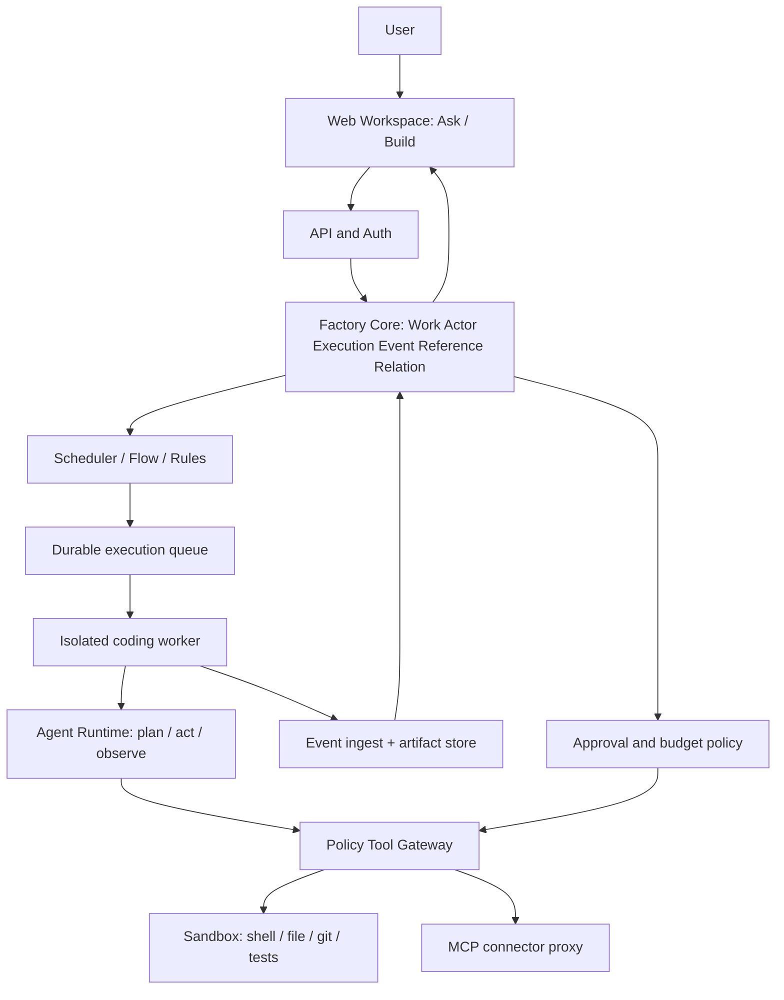

# Software Factory — Integrated System Architecture

**Status:** normative build baseline | **Version:** 6.0 | **Product name:** Software Factory

## Objective and scope
One unified software-production platform: conversational intake, Work coordination, autonomous coding, verification, human review and delivery. Preserve the six Factory domain primitives: **Work, Actor, Execution, Event, Reference, Relation**. Autonomous coding is an implementation of an Actor/Worker runtime, never a replacement for the Core.

## Logical architecture

## Component ownership
| Component | Owns | Must not own |
|---|---|---|
| Factory Core | Work lifecycle, Execution identity, append-only events, references | LLM prompts or tool subprocesses |
| Scheduler | eligibility, lease and retry decisions | arbitrary source-code edits |
| Agent Runtime | plan, context, model requests, tool selection | policy grants, project-wide budgets |
| Tool Gateway | tool validation, authz, audit, quotas | business Work state |
| Sandbox Worker | ephemeral filesystem and processes | durable Factory state |
| Workspace UI | projections, review and approvals | authorization enforcement |

## Run lifecycle
1. User requests Build; server creates Work (draft or open) and associates repository Reference.
2. Scheduler selects Actor and creates Execution (`queued`) with immutable policy version, budget, base commit and task envelope.
3. Worker claims leased execution; adapter initializes context and starts bounded agent loop.
4. Each tool call passes Tool Gateway; gateway evaluates authorization, quotas and required approval.
5. Worker streams ordered events; artifact objects are content-addressed and referenced, never embedded as large event payloads.
6. Worker returns patch, test evidence and terminal outcome; Factory Core commits state transition idempotently.
7. UI presents diff and evidence; merge, release and deploy remain separate gated operations.

## Non-negotiable invariants
- One authoritative owner of Execution state: Factory Core.
- Every external side effect has actor identity, execution ID, policy version and audit record.
- No raw model output may directly authorize privileged operations.
- Retried events and callbacks are idempotent; ordering is per Execution, not global.
- Secrets never enter prompts or durable logs; untrusted repository text cannot override policy.
- Agent may be swapped without changing six primitive schemas.

## Failure handling
Lease timeout → mark worker lost → recover from safe checkpoint or restart in new sandbox. Tool timeout → classify transient/permanent and bounded retry. Repeated identical no-progress steps → stall detection and stop/escalate. Budget exhausted → suspend and request explicit additional budget. Git conflict → rebase in new worktree and re-run verification; never force push.

## Source-of-truth precedence
For integrated implementation, documents 31–36 and `00_START_HERE.md` take precedence on overlaps with legacy v5 files. Legacy files retain detailed product intent and UX specifications.
